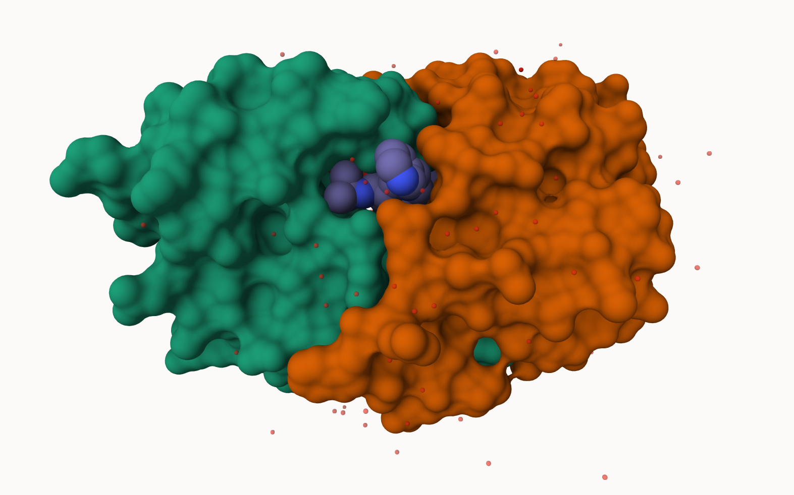
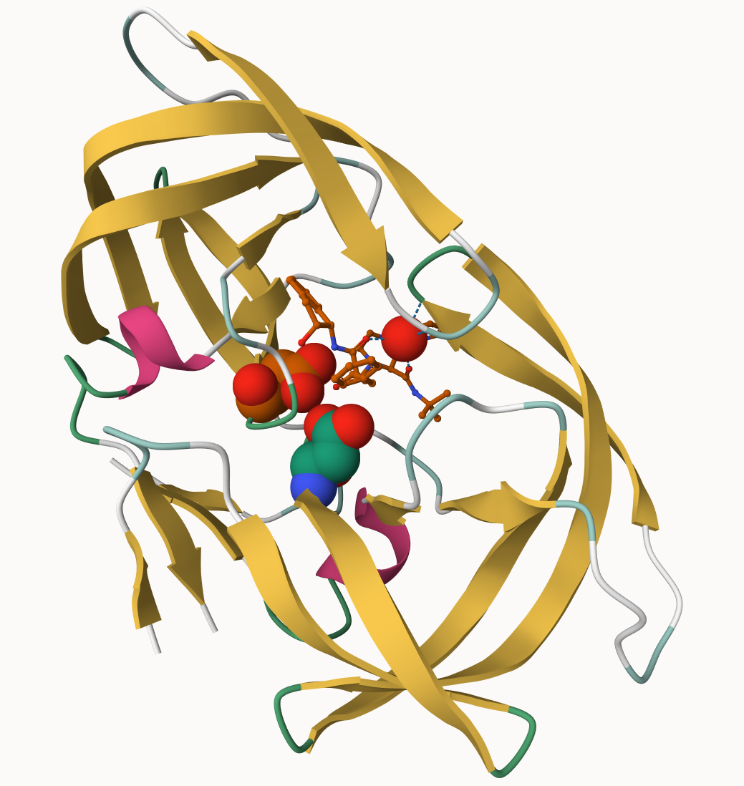

# Introduction to the RCSB Protein Data Bank (PDB)

## PDB Statistics

```{r}
stats <- read.csv("pdb_stats.csv", row.names = 1)
stats
```

> **Q1.** What percentage of structures in the PDB are solved by X-Ray and Electron Microscopy?

```{r}
total <- apply(stats,2,sum)
total
```

```{r}
n_xray <- sum(stats$X.ray)
n_em <- sum(stats$EM)
n_total <- sum(stats$Total)

p_xray <- (n_xray/n_total) * 100
round(p_xray,2)
p_em <- (n_em/n_total) * 100
round(p_em,2)
p_xray_em <- p_xray + p_em
round(p_xray_em,2)
```

> **Answer:** 80.95% of structures in the PDB are solved by X-Ray. 12.84% are solved by Electron Microscopy. If you add the two percentages together, 93.79% are solved by X-Ray and Electron Microscopy.

> **Q2.** What proportion of structures in the PDB are protein?

```{r}
n_protein <- stats["Protein (only)", "Total"]
p_protein <- (n_protein/n_total) * 100
round(p_protein,2)
```

> **Answer:** 85.97% of structures in the PDB are protein

> **Q3.** Type HIV in the PDB website search box on the home page and determine how many HIV-1 protease structures are in the current PDB?

> **Answer:** There are 1,198 HIV-1 protease structures in the current PDB.

# Visualizing the HIV-1 Protease Structure



## The Important Role of Water

> **Q4.** Water molecules normally have 3 atoms. Why do we see just one atom per water molecule in this structure?

> **Answer:** Hydrogen is not visible at this resolution (2 Angstrom). We would need a resolution of 1 Angstorm or lower to see the Hydrogen atoms.

> **Q5.** There is a critical "conserved" water molecule in the binding site. Can you identify this water molecule? What residue number does this water molecule have?

> **Answer:** Yes. Water HOH 308.

> **Q6.** Generate and save a figure clearly showing the two distinct chains of HIV-protease along with the ligand. You might also consider showing the catalytic residues ASP 25 in each chain and the critical water (we recommend "Ball & Stick" for these side-chains). Add this figure to your Quarto document.



# Introduction to Bio3D in R

## Reading PDB File Data into R

```{r}
library(bio3d)
pdb <- read.pdb("1hsg")
pdb
```

> **Q7.** How many amino acid residues are there in this pdb object?

> **Answer:** There are 198 amino acid residues.

> **Q8.** Name one of the two non-protein residues?

> **Answer:** HOH (water) or MK1 (the drug inhibitor ligand).

> **Q9.** How many protein chains are in this structure?

> **Answer:** 2 (Chains A and B)

> Note that the attributes (+ attr:) of this object are listed on the last couple of lines. To find the attributes of any such object you can use:

```{r}
attributes(pdb)
```

> To access these individual attributes we use the dollar-attribute name convention that is common with R list objects. For example, to access the atom attribute or component use pdb\$atom:

```{r}
head(pdb$atom)
```

## Predicting Functional Motions of a Single Structure

> Let’s read a new PDB structure of Adenylate Kinase and perform Normal mode analysis.

```{r}
adk <- read.pdb("6s36")
```

```{r}
adk
```

> Normal mode analysis (NMA) is a structural bioinformatics method to predict protein flexibility and potential functional motions (a.k.a. conformational changes).

```{r}
# Perform flexibility prediction
m <- nma(adk)
```

```{r}
# Temporarily shrink the inner margins using par() before running plot()
par(mar = c(2,2,2,2))
plot(m)
```

> To view a “movie” of these predicted motions we can generate a molecular “trajectory” with the mktrj() function.

```{r}
mktrj(m, file="adk_m7.pdb")
```

> Now we can load the resulting “adk_m7.pdb” PDB into Mol\* with the “Open Files” option on the right side control panel. Once loaded click the “play” button to see a movie (see image below). We will discuss how this method works at the end of this lab when we apply it across a large set of homologous structures.

> Alternatively, for a quicker display you can use the view.nma() function from the bio3dview package mentioned previously:

```{r}
#view.nma(m, pdb=adk)
```

# Comparative Structure Analysis of Adenylate Kinase

## Setup

> We will begin by first installing the packages we need for today’s session. Note that if you have followed along with the previous sections then you will already have all but the last of these (i.e. you will just need to install the msa package).

```{r}
# Install packages in the R console NOT your Rmd/Quarto file

# install.packages("bio3d")
# install.packages("NGLVieweR")

# install.packages("remotes")
# remotes::install_github("bioboot/bio3dview")

# install.packages("BiocManager")
# BiocManager::install("msa")
```

> **Q10.** Which of the packages above is found only on BioConductor and not CRAN?

> **Answer:** msa

> **Q11.** Which of the above packages is not found on BioConductor or CRAN?

> **Answer:** bio3dview

> **Q12.** True or False? Functions from the pak package can be used to install packages from GitHub and BitBucket?

> **Answer:** True. R packages found on GitHUb or BitBucket can be installed using devtools::install_github() and devtools::install_gitbucket() functions.

## Search and Retrieve ADK Structures

Below we perform a blast search of the PDB database to identify related structures to our query Adenylate kinase (ADK) sequence. In this particular example we use function get.seq() to fetch the query sequence for chain A of the PDB ID 1AKE and use this as input to blast.pdb(). Note that get.seq() would also allow the corresponding UniProt identifier.

```{r}
library(bio3d)
aa <- get.seq("1ake_A")
```

```{aa}
```

> **Q13.** How many amino acids are in this sequence, i.e. how long is this sequence?

> **Answer:** This sequence is 214 amino acids long.

```{r}
hits <- NULL
hits$pdb.id <- c('1AKE_A','6S36_A','6RZE_A','3HPR_A','1E4V_A','5EJE_A',
                 '1E4Y_A','3X2S_A','6HAP_A','6HAM_A','4K46_A','3GMT_A',
                 '4PZL_A')
```

> The Blast search and subsequent filtering identified a total of 13 related PDB structures to our query sequence. The PDB identifiers of this collection are accessible through the $pdb.id attribute to the hits object (i.e. hits$pdb.id). Note that adjusting the cutoff argument (to plot.blast()) will result in a decrease or increase of hits.

> We can now use function get.pdb() and pdbslit() to fetch and parse the identified structures.

```{r}
# Download releated PDB files
files <- get.pdb(hits$pdb.id, path="pdbs", split=TRUE, gzip=TRUE)
```

## Align and Superpose Structures

> Next we will use the pdbaln() function to align and also optionally fit (i.e. superpose) the identified PDB structures.

```{r}
# Align releated PDBs
pdbs <- pdbaln(files, fit = TRUE, exefile="msa")
```

## Annotate Collected PDB Structures

> The function pdb.annotate() provides a convenient way of annotating the PDB files we have collected. Below we use the function to annotate each structure to its source species. This will come in handy when annotating plots later on:

```{r}
# Vector containing PDB database codes
ids <- basename.pdb(pdbs$id)

anno <- pdb.annotate(ids)
unique(anno$source)
```

> We can view all available annotation data:

```{r}
anno
```

## Principal Component Analysis

> PCA can be performed on the structural ensemble (stored in the pdbs object) with the function pca.xyz(), or more simply pca().

```{r}
# Perform PCA
pc.xray <- pca(pdbs)
plot(pc.xray)
```

> Function rmsd() will calculate all pairwise RMSD values of the structural ensemble. This facilitates clustering analysis based on the pairwise structural deviation:

```{r}
# Calculate RMSD
rd <- rmsd(pdbs)

# Structure-based clustering
hc.rd <- hclust(dist(rd))
grps.rd <- cutree(hc.rd, k=3)

plot(pc.xray, 1:2, col="grey50", bg=grps.rd, pch=21, cex=1)
```

## PCA Visualization

> To visualize the major structural variations in the ensemble the function mktrj() can be used to generate a trajectory PDB file by interpolating along a give PC (eigenvector):

```{r}
# Visualize first principal component
pc1 <- mktrj(pc.xray, pc=1, file="pc_1.pdb")
```

> We can also plot our main PCA results with ggplot:

```{r}
#Plotting results with ggplot2
library(ggplot2)
library(ggrepel)

df <- data.frame(PC1=pc.xray$z[,1], 
                 PC2=pc.xray$z[,2], 
                 col=as.factor(grps.rd),
                 ids=ids)

p <- ggplot(df) + 
  aes(PC1, PC2, col=col, label=ids) +
  geom_point(size=2) +
  geom_text_repel(max.overlaps = 20) +
  theme(legend.position = "none")
p
```

# Normal Mode Analysis

> Function nma() provides normal mode analysis (NMA) on both single structures (if given a singe PDB input object) or the complete structure ensemble (if provided with a PDBS input object). This facilitates characterizing and comparing flexibility profiles of related protein structures.

```{r}
# NMA of all structures
modes <- nma(pdbs)
```

```{r}
plot(modes, pdbs, col=grps.rd)
```

> **Q14.** What do you note about this plot? Are the black and colored lines similar or different? Where do you think they differ most and why?

> **Answer:** The black line and the colored lines show very similar baseline fluctuations across most of the sequence, but diverge significantly in specific regions. The greatest differences occur around residues \~120-160 and residues \~30-60. These regions undergo large-scale conformational shifts upon ligand binding, resulting in distinct flexbilities between the open and substrate-bound states.
