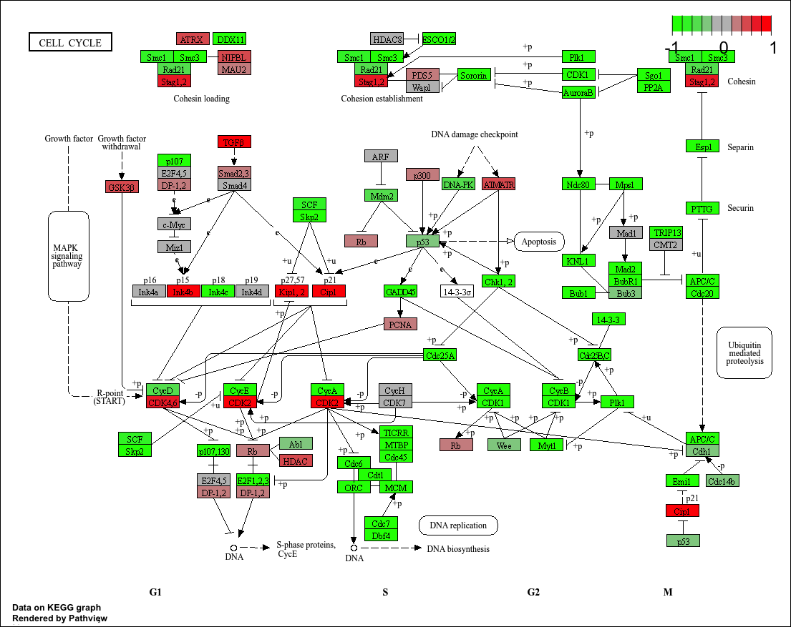
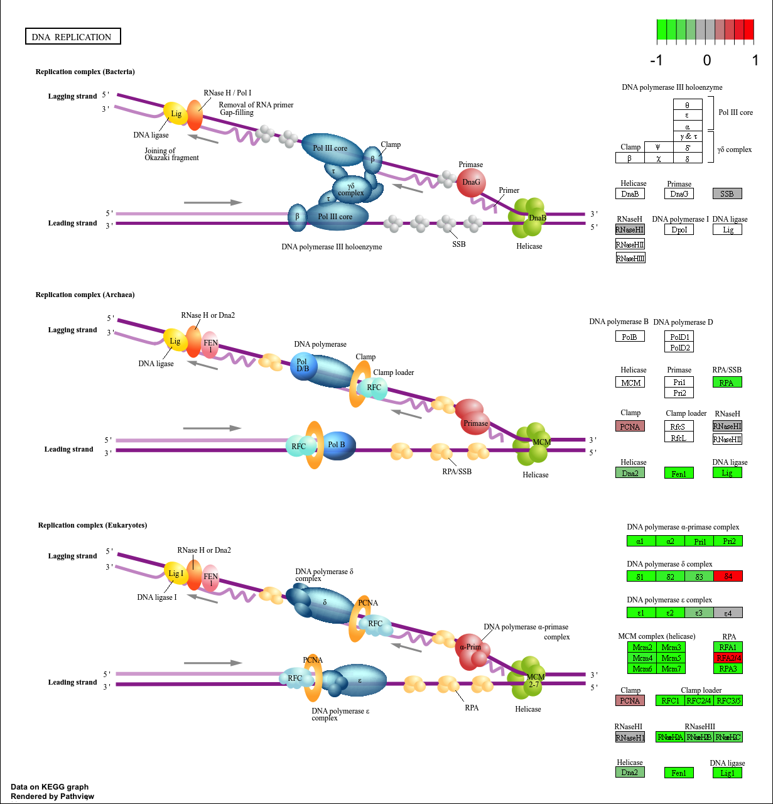
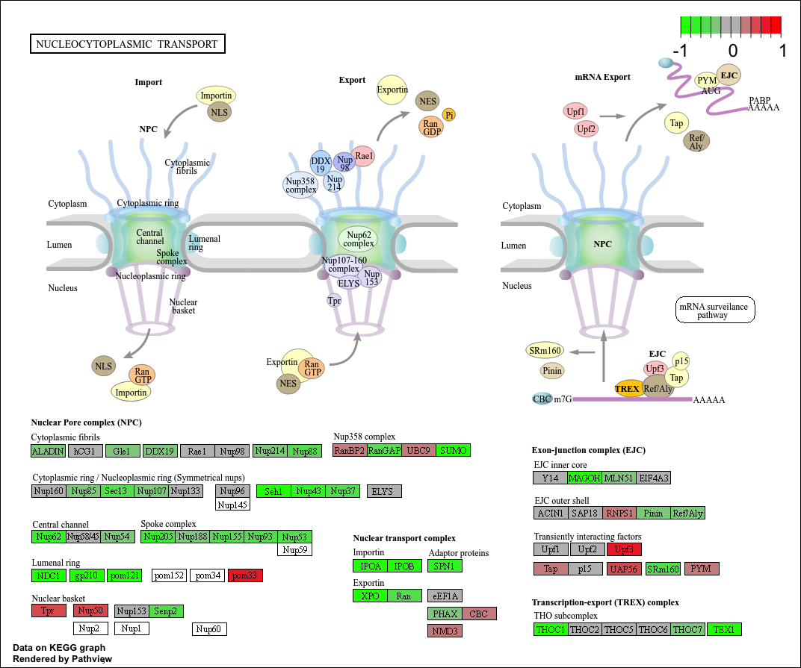
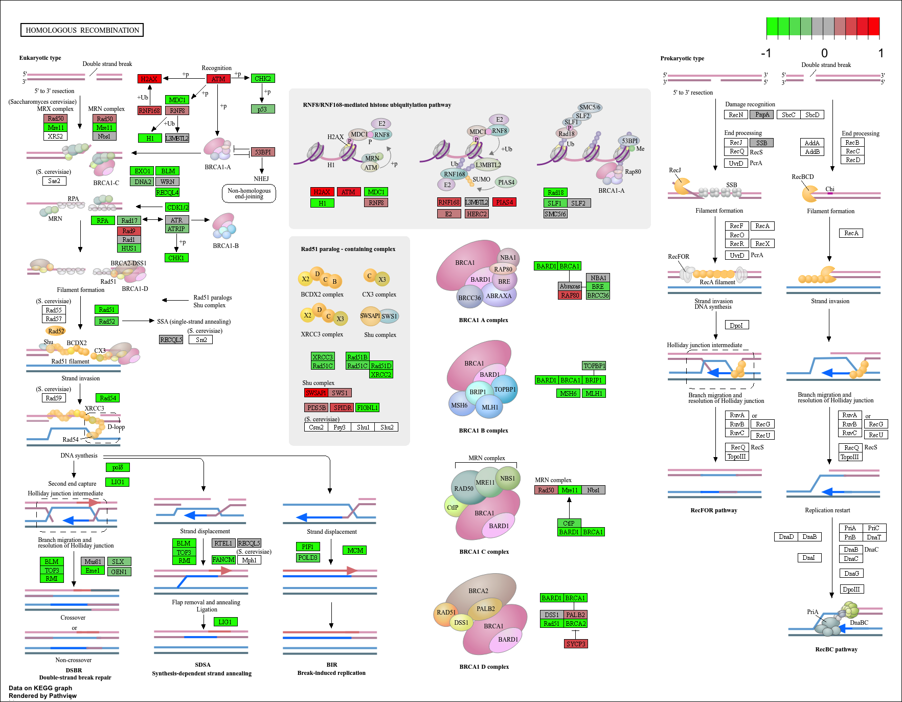
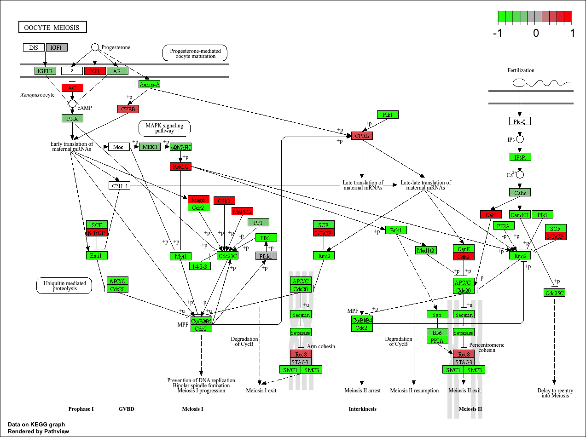

## Section 1. Differential Expression Analysis

```{r}
library(DESeq2)
```

```{r}
# Load our data files
metaFile <- "GSE37704_metadata.csv"
countFile <- "GSE37704_featurecounts.csv"

# Import metadata and take a peak
colData = read.csv(metaFile, row.names=1)
head(colData)
```

```{r}
# Import countdata
countData = read.csv(countFile, row.names=1)
head(countData)
```

> **Q1.** Complete the code below to remove the troublesome first column from countData.

```{r}
countData <- as.matrix(countData[,-1])
head(countData)
```

> **Q2.** Complete the code below to filter countData to exclude genes (i.e. rows) where we have 0 read count across all samples (i.e. columns).

```{r}
countData = countData[rowSums(countData) > 0,]
head(countData)
```

## Running DESeq2

```{r}
# Setup the DESeqDataSet object required for the DESeq() function
dds = DESeqDataSetFromMatrix(countData=countData,
                             colData=colData,
                             design=~condition)
```

```{r}
# Run the DESeq pipeline
dds = DESeq(dds)
```

```{r}
dds
```

```{r}
# Get results for the HoxA1 knockdown versus control siRNA
res = results(dds)
```

> **Q3.** Call the summary() function on your results to get a sense of how many genes are up or down-regulated at the default 0.1 p-value cutoff.

```{r}
summary(res)
```

## Volcano Plot

```{r}
# Make a volcano plot
library(ggplot2)

ggplot(res) + aes(log2FoldChange, -log(padj)) + geom_point()
```

> **Q4.** Improve this plot by completing the below code, which adds color, axis labels, and cutoff lines:

```{r}
# Make a color vector for all genes
mycols <- rep("gray", nrow(res))

# Color blue the genes with fold change above 2
mycols[ abs(res$log2FoldChange) > 2 ] <- "blue"

# Color gray those with adjusted p-value more than 0.01
mycols[ res$padj > 0.01 ] <- "gray"

ggplot(res) +
  aes(log2FoldChange,
      -log(padj)) +
  geom_point(col=mycols) +
  xlab("Log2(FoldChange)") +
  ylab("-Log(P-value)") +
  geom_vline(xintercept = c(-2,2)) +
  geom_hline(yintercept = -log(0.05))
```

## Adding Gene Annotation

> **Q5.** Use the mapIDs() function multiple times to add SYMBOL, ENTREZID and GENENAME annotation to our results by completing the code below.

```{r}
library("AnnotationDbi")
library("org.Hs.eg.db")

columns(org.Hs.eg.db)

res$symbol = mapIds(org.Hs.eg.db,
                    keys=row.names(res), 
                    keytype="ENSEMBL",
                    column="SYMBOL",
                    multiVals="first")

res$entrez = mapIds(org.Hs.eg.db,
                    keys=row.names(res),
                    keytype="ENSEMBL",
                    column="ENTREZID",
                    multiVals="first")

res$name =   mapIds(org.Hs.eg.db,
                    keys=row.names(res),
                    keytype="ENSEMBL",
                    column="GENENAME",
                    multiVals="first")

head(res, 10)
```

> **Q6.** Finally for this section let's reorder these results by adjusted p-value and save them to a CSV file in your current project directory.

```{r}
res = res[order(res$pvalue),]
write.csv(res, file="deseq_results.csv")
```

# Section 2. Pathway Analysis

```{r}
# Run in your R console (i.e. not your Rmarkdown doc!)
#BiocManager::install( c("pathview", "gage", "gageData") )

# For old versions of R only (R < 3.5.0)!
#source("http://bioconductor.org/biocLite.R")
#biocLite( c("pathview", "gage", "gageData") )
```

```{r}
library(pathview)
library(gage)
library(gageData)

data(kegg.sets.hs)
data(sigmet.idx.hs)

# Focus on signaling and metabolic pathways only
kegg.sets.hs = kegg.sets.hs[sigmet.idx.hs]

# Examine the first 3 pathways
head(kegg.sets.hs, 3)
```

```{r}
foldchanges = res$log2FoldChange
names(foldchanges) = res$entrez
head(foldchanges)
```

> Now, let's run the gage pathway analysis.

```{r}
# Get the results
keggres = gage(foldchanges, gsets=kegg.sets.hs)
```

> Now lets look at the object returned from gage().

```{r}
attributes(keggres)
```

> Lets look at the first few down (less) pathway results:

```{r}
# Look at the first few down (less) pathways
head(keggres$less)
```

> Now, let's try out the pathview() function from the pathview package to make a pathway plot with our RNA-Seq expression results shown in color. To begin with lets manually supply a pathway.id (namely the first part of the "hsa04110 Cell cycle") that we could see from the print out above.

```{r}
pathview(gene.data=foldchanges, pathway.id="hsa04110")
```

> This downloads the pathway figure data from KEGG and adds our results to it. Here is the default low resolution raster PNG output from the pathview() call above:



> You can play with the other input arguments to pathview() to change the display in various ways including generating a PDF graph. For example:

```{r}
# A different PDF based output of the same data
pathview(gene.data=foldchanges, pathway.id="hsa04110", kegg.native=FALSE)
```

> Now, let's process our results a bit more to automagicaly pull out the top 5 upregulated pathways, then further process that just to get the pathway IDs needed by the pathview() function. We'll use these KEGG pathway IDs for pathview plotting below.

```{r}
## Focus on top 5 upregulated pathways here for demo purposes only
keggrespathways <- rownames(keggres$greater)[1:5]

# Extract the 8 character long IDs part of each string
keggresids = substr(keggrespathways, start=1, stop=8)
keggresids
```

> Finally, lets pass these IDs in keggresids to the pathview() function to draw plots for all the top 5 pathways.

```{r}
pathview(gene.data=foldchanges, pathway.id=keggresids, species="hsa")
```

> **Q7.** Can you do the same procedure as above to plot the pathview figures for the top 5 down-regulated pathways?

```{r}
# Focus on top 5 downregulated pathways here for demo
keggrespathways.down <- rownames(keggres$less) [1:5]

# Extract the 8 character long IDS part of each string
keggresids.down = substr(keggrespathways.down, start=1, stop=8)
keggresids.down
```

```{r}
# Plot pathview figures for top 5 downregulated pathways
pathview(gene.data=foldchanges, pathway.id=keggresids.down, species="hsa")
```










# Section 3. Gene Ontology (GO)

```{r}
data(go.sets.hs)
data(go.subs.hs)

# Focus on Biological Process subset of GO
gobpsets = go.sets.hs[go.subs.hs$BP]

gobpres = gage(foldchanges, gsets=gobpsets)

lapply(gobpres, head)
```
# Section 4. Reactome Analysis

```{r}
sig_genes <- res[res$padj <= 0.05 & !is.na(res$padj), "symbol"]
print(paste("Total number of significant genes:", length(sig_genes)))
```

```{r}
write.table(sig_genes, file="significant_genes.txt", row.names=FALSE, col.names=FALSE, quote=FALSE)
```

> **Q8.** What pathway has the most significant “Entities p-value”? Do the most significant pathways listed match your previous KEGG results? What factors could cause differences between the two methods?

> **Answer:** The pathway that has the most significant "Entities p-value" is the Cell Cycle/Cell Cycle, Mitotic. This matches the KEGG results, where the Cell Cycle was the most significantly downregulated and upregulated pathway. The factors that could cause differences between the two methods include using different pathway definitions, gene IDS, and statistical methods. 